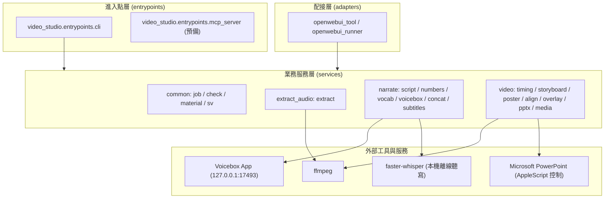

# 系統架構 (Architecture)

> 手動維護本檔的「系統概覽」；以下報告由工具自動產生，請勿手動修改。

| 文件 | 內容 | 產生方式 |
|---|---|---|
| [`PROJECT_TREE.md`](PROJECT_TREE.md) | 完整目錄樹 | `agentctl sync` / 每次 commit |
| `GRAPH_REPORT.md` | 模組依賴圖、分層檢查、函式大小 | 需要時 `agentctl graph`（不進 git） |
| `AGENT_AUDIT_REPORT.md` | 各 Agent 的 commit 與任務 | 需要時 `agentctl audit`（不進 git） |

## 系統概覽

`video-studio` 是一個以語音生成（Voicebox TTS）、音訊提取（ffmpeg）、字幕處理（Whisper、OpenCC）與畫面合成渲染（PowerPoint、高解析度海報鏡頭動畫）為核心的影片製作系統。



### 三種工作類型 (Job Types)

每一份工作（job）屬於下面其中一類，放在工作區對應的資料夾中，資料與程式徹底分離：

| 類型 | 資料夾 | 使用者提供 | 產出 | 時間基準 |
|---|---|---|---|---|
| **只提取聲音** | `extract/` | 影片 | 音檔；可選：聲音樣本、逐字稿、對齊原片字幕 | 原片 |
| **重新配音** | `dub/` | 影片（畫面保留）＋講稿 | 新配音、字幕、換掉聲音的影片 | **原片畫面** |
| **完整生成** | `generate/` | 講稿／pptx／海報／主題說明 | 配音、字幕、影片 | **配音時間** |

### 工作區目錄架構 (Workspace Structure)

程式透過 `video_studio.config.settings` 取得 `DATA_DIR` / `workspace` 路徑：

```text
workspace/
├── shared/                       所有工作共用
│   ├── vocabulary.tsv            詞彙表：字幕顯示 vs Voicebox 念法
│   └── voice/samples/            複製聲音的音訊樣本
├── extract/<job-name>/
├── dub/<job-name>/
└── generate/<job-name>/
    ├── job.toml                  工作設定檔
    ├── input/                    原始素材（程式不可修改）
    ├── review/                   AI 起草、待確認檔案（確認後透過 approve 移入 input/）
    ├── work/                     中間處理檔（takes/、暫存，可清理）
    └── output/v1, v2, …          成品（版本遞增，永不覆蓋）
```

## 分層

見 `.agents/project.toml` 的 `[architecture] layers` 與 [`ARCHITECTURE_RULES.md`](../standards/ARCHITECTURE_RULES.md)。
- `entrypoints`: 命令列入口與 CLI 分發。
- `adapters`: 外部平台（如 Open WebUI Tool）配接與隔離。
- `services`: 業務流程（音訊提取、朗讀配音、分鏡與影片渲染、工作區檢核）。
- `domain`: 領域型別與共用實體。
- `config`: 環境變數與路徑設定。
