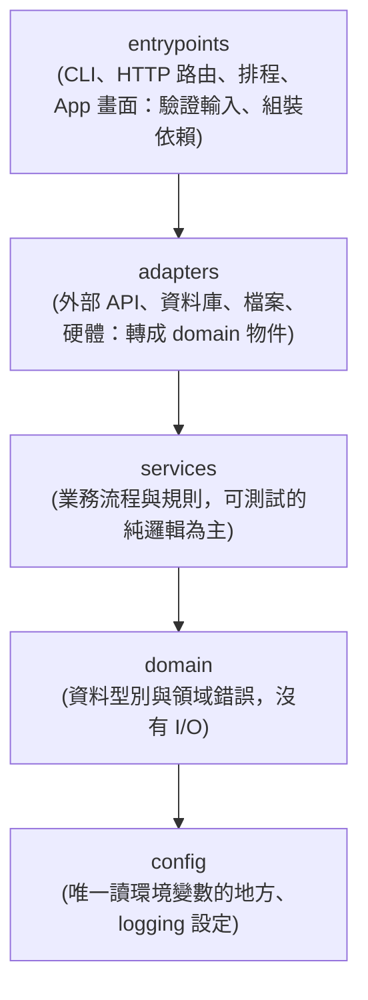

# 系統架構與十項工程守則 (Architecture Rules & 10 Guardrails)

> **AI Agent 載入時機**：當需要新增模組、調整目錄結構、修改 `.agents/project.toml` 分層設定、串接外部 API 或修改儲存層時，**必須閱讀並遵守本文件**。

---

## 1. 可配置的單向依賴與分層邊界 (Configurable Unidirectional Layering)

語言範本預設五層（`.agents/project.toml` → `[architecture] layers`，由上而下）；上層可以引用下層，下層**不可**引用上層：

- 依賴注入：`entrypoints` 建立 adapter 再交給 service（service 只認得參數，不自己連網或讀檔），所以測試可以傳入假的 adapter。
- **自訂分層範例**（各專案可在 `[architecture]` 改名稱、`source_roots` 與 `workspaces`）：
  - DDD / Clean Architecture：`layers = ["presentation", "application", "infrastructure", "domain"]`
  - Web MVC / Service：`layers = ["routes", "controllers", "services", "repositories", "models", "utils"]`
  - 同一層的多個資料夾：`layers = ["entrypoints", ["adapters", "store"], "services", "domain", "config"]`
- `python3 scripts/agentctl.py check`（以及 `agentctl graph`）會讀 `layers` 順序，發現下層反向引用上層就失敗。

---

## 2. 大型與跨語言專案必須遵守的 10 大工程守則

1. **單向依賴原則 (Unidirectional Dependency)**：
   - 依賴方向必須嚴格遵循 `.agents/project.toml` 中 `[architecture] layers` 由上至下的順序，下層嚴禁反向引用上層，禁止循環依賴。
2. **環境零污染 (Zero Global Pollution)**：
   - 專案用到的套件與工具只裝在專案內（Python `.venv/` 由 uv 管理、Node `node_modules/` 由 pnpm 管理），版本由鎖定檔固定；主機只放共用的系統工具。完整規則見 [`ENVIRONMENT_AND_DEPENDENCIES.md`](ENVIRONMENT_AND_DEPENDENCIES.md)。
   - 金鑰只放 `.env`（不進 git）；憑證檔放專案外的 `~/.config/<專案>/`（權限 600）。
3. **外部 API 防腐層 (Anti-Corruption Layer)**：
   - `adapters`（或基礎設施層）必須將第三方 API 的原始格式轉換為內部標準 DTO，並捕捉 HTTP 429/5xx 轉為標準領域錯誤，不讓第三方格式滲透進核心領域層。
4. **核心與 I/O 解耦**：
   - `services` 只透過參數拿到 adapter（或函式），不自己連網、讀檔、讀環境變數；正式環境與離線測試跑的是同一份流程，只是傳入的 adapter 不同。
5. **冪等性與防重送 (Idempotency & Deduplication)**：
   - 接收外部 Webhook、訊息佇列或重試請求時，入口層應具備冪等去重機制，防止重複執行副作用。
6. **並發鎖不可跨網路呼叫 (Short-Lived Locks)**：
   - 儲存層內的 `Read-Modify-Write` 必須加鎖或使用資料庫交易，但**嚴禁在持有鎖期間呼叫外部慢速網路 API**，避免鎖超時與全系統排隊卡死。
7. **外部依賴降級與狀態補償守則 (Fallback & Compensating Transactions)**：
   - 外部服務失敗時優先切換備援，若最終仍失敗，必須執行對應的狀態回滾或補償操作（可在 `.agents/project.toml` 的 `[project_rules] paired_calls` 定義專案專屬的成對呼叫檢查，例如 `[["begin_tx", "rollback_tx"]]` 或 `[["check_and_consume_quota", "refund_quota"]]`），並回覆使用者友善錯誤訊息。
8. **資料容量防衛與結構向下相容 (Storage Hygiene & Schema Evolution)**：
   - 寫入儲存層前限制單筆大小，新增欄位或遷移 Schema 時保持向下相容，並在 `docs/architecture/ARCHITECTURE.md` 的資料模型段落記錄（資料庫結構以 Alembic 遷移檔為準）。
9. **目錄樹與多 Agent 入口防脫節檢查 (Drift Detection)**：
   - 檔案增刪或規則調整後，由 `python3 scripts/agentctl.py tree` 與 `python3 scripts/agentctl.py sync` 自動同步目錄樹與各 AI Agent 入口檔。
10. **四向溯源體系 (Four-Way Traceability)**：
    - 重要設計取捨必留 `ADR-NNN`（`docs/adr/`），踩坑與規避必留 `ISSUE-NNN`（`docs/known-issues/`），並在程式碼註解、測試案例與 Commit 訊息中雙向互連。

---

## 3. Web API 規則（FastAPI）

> 新專案的 HTTP 伺服器**一律使用 FastAPI**（母版的 `scripts/init_project.py --with api`）。`[project_rules] forbidden_imports` 預設禁止 `flask`；只有以維護模式遷移、已完工的舊專案可以保留 Flask。

1. **結構**：路由在 `src/<pkg>/entrypoints/http/`，由 `create_app(config)` 組合 `APIRouter`；輸入輸出格式（pydantic）放 `schemas.py`。
2. **只在邊界驗證**：請求進來先由 pydantic 模型驗證（錯誤自動 422），轉成 domain 物件後才交給 services；services 不碰 request / response。
3. **路由要薄**：驗證輸入 → 呼叫 service → 轉成輸出格式；業務邏輯不寫在路由裡。
4. **依賴當參數傳入**：設定、資料庫 session factory 透過 `create_app(...)` 參數或 `Depends` 注入，測試用 `TestClient(create_app(test_config, ...))`，不需要真的啟動伺服器。
5. **錯誤**：預期的錯誤用 `HTTPException(status_code=..., detail=...)`；不要把例外訊息或堆疊直接回給使用者。
6. **只綁 `127.0.0.1`**：`HTTP_HOST` 預設 `127.0.0.1`，不改成 `0.0.0.0`；API 文件在 `http://127.0.0.1:<port>/docs`。
7. **給 AI 工具用（使用者要網頁時一律做到；動手前先依 [`LOCAL_AI_ENVIRONMENT.md`](LOCAL_AI_ENVIRONMENT.md) §2 確認需求）**：
   - **一組 services、三個入口**：HTTP 路由、MCP 工具（`entrypoints/mcp_server.py`）、網頁。功能只寫在 `services`，入口只做轉換，三邊結果才會一致。
   - **OpenAPI**：每個路由的函式名稱就是 operationId（`generate_unique_id_function`），docstring 寫清楚用途與參數；Open WebUI 可以直接把 `http://127.0.0.1:<port>` 加成 OpenAPI 工具伺服器。
   - **MCP**：同一個伺服器在 `/mcp` 提供 Streamable HTTP；`uv run <name>-mcp` 提供 stdio。專案根目錄的 `.mcp.json`（Claude Code）、`opencode.json`（OpenCode）、`.agents/mcp_config.json`（Antigravity）、`.cursor/mcp.json`、`.vscode/mcp.json` 讓各工具打開專案就找得到；其他工具見 `docs/INTEGRATIONS.md`。
   - **最低權限**：讀取的工具可直接呼叫；寫入、刪除、提交、部署的工具要有 `confirm: bool`，沒有使用者同意就拒絕並說明會做什麼。
   - **只接受本機**：Host 只能是 127.0.0.1 / localhost（加上 `HTTP_ALLOWED_HOSTS`）；網頁送出的修改請求只接受本專案與 `HTTP_ALLOWED_ORIGINS`（預設 Open WebUI `http://127.0.0.1:8080`，並開放它的 CORS）。
   - **stdio 的 MCP 不可 print 到 stdout**（stdout 是 MCP 的通道）；log 一律走 logger（stderr 與 `DATA_DIR/logs/`）。

## 4. 資料庫規則（SQLAlchemy 2.0 + Alembic + SQLite）

1. **位置**：ORM 模型、engine / session、repository 都在 `src/<pkg>/adapters/db/`；其他層只拿到 domain 物件，不 import ORM 模型。
2. **連線**：`DATABASE_URL` 只在 config 層讀取（留空 = `<DATA_DIR>/db/app.db`，在專案資料夾之外）；換 PostgreSQL 只改 `.env`。
3. **交易**：一律用 `session_scope()`（成功 commit、錯誤 rollback）；**不要在交易中呼叫外部 API 或做長時間運算**。
4. **改資料表一定要有遷移檔**：修改 `models.py` 後執行 `uv run alembic revision --autogenerate -m "..."`，檢查並補上遷移檔開頭的說明；`agentctl check` 的 `dbcheck`（`alembic upgrade head && alembic check`）會在模型與遷移不一致時失敗。
5. **不要手動改資料庫結構**（例如用 SQLite 工具直接加欄位），也不要修改已經 commit 的遷移檔；要改就新增一個 revision。
6. **測試**：用記憶體資料庫（`create_db_engine("sqlite://")` + `Base.metadata.create_all`），不讀寫 `DATA_DIR` 的真實資料庫。

## 5. 資料與程式分離

1. **資料不放在專案資料夾內**：輸入、輸出、隔離區、進度狀態、SQLite、log 都放在 `.env` 的 `DATA_DIR`（預設相對路徑 `../../projects-data/<專案>`，從專案資料夾算起；外接硬碟時寫絕對路徑）。標準結構：`input/`、`output/`、`needs_review/`、`state/`、`db/`、`logs/`。
2. **程式只透過 config 取得路徑**：用 `AppConfig.data_dir`、`input_dir`、`output_dir`、`needs_review_dir`、`state_dir`、`logs_dir`，其他層收參數；不要寫死 `data/...` 或絕對路徑。
3. **專案內只放程式、文件和小型測試樣本**（`tests/fixtures/`、`evals/cases/`，每個檔案 ≤ 1 MB）。pre-commit 會擋下 PDF、EPUB、壓縮檔、影音、資料庫與超過 10 MB 的檔案（文件型專案可設 `[quality] block_data_files = false`）。
4. **批次處理不中斷**：單一項目失敗或信心度不足時，寫入 `needs_review/`（附原因），繼續處理下一個。
5. **原始輸入唯讀**：處理流程不修改 `input/` 的原始檔，產出一律寫到 `output/`。
