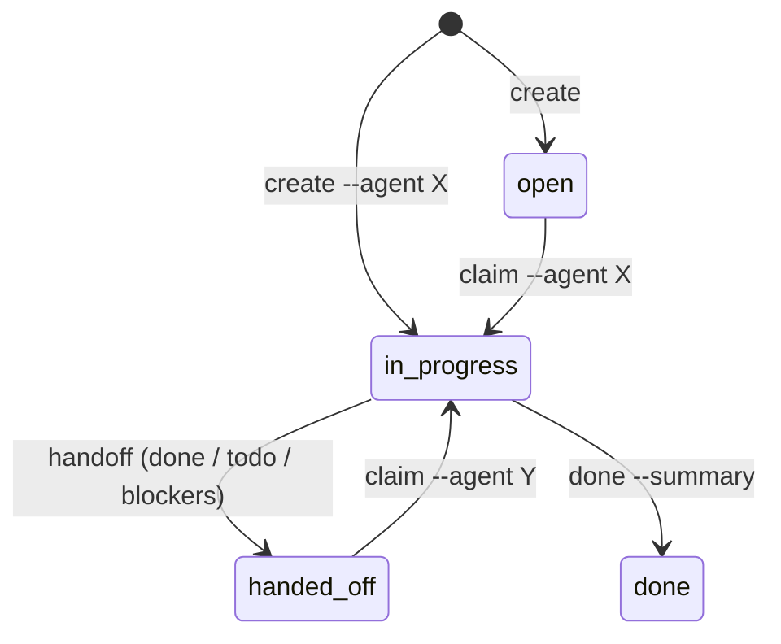

# Agent 輪流接力協作規範 (Sequential Multi-Agent Handoff)

> **AI Agent 載入時機**：開始一段新對話、接手別人的任務、要把任務交給下一位 Agent，或結束對話時。
>
> **前提**：同一時間只有一個 Agent 在修改程式。不同 Agent（Claude Code、Gemini/Antigravity、Cursor、Windsurf、Copilot、Codex）或同一個 Agent 的不同對話**輪流**接手，所以重點是「交接清楚、紀錄可追溯」，不是平行鎖定。

---

## 1. 單一規則來源

| 角色 | 檔案 | 維護方式 |
|---|---|---|
| 規則與設定（唯一來源） | `AGENTS.md`、`.agents/project.toml` | 手動修改 |
| Claude Code 入口 | `CLAUDE.md`（`@AGENTS.md`）、`.claude/skills/` | `agentctl sync` 自動產生 |
| Gemini / Antigravity | `GEMINI.md` | 自動產生 |
| GitHub Copilot | `.github/copilot-instructions.md` | 自動產生 |
| Cursor / Windsurf | `.cursor/rules/`、`.windsurf/rules/` | 自動產生 |

`CLAUDE.md` 直接匯入 `AGENTS.md`；其他入口檔**複製** `AGENTS.md` 裡 `<!-- RULES_START -->` 到 `<!-- RULES_END -->` 的規則段落，再附上 Skills 索引。所以規則只改 `AGENTS.md`，再執行 `agentctl sync`，所有工具就會一致。

## 2. 開工（每次對話開始）

```bash
python3 scripts/agentctl.py status
```

會顯示：交接看板 (`.agents/handoff/LATEST.md`) 的即時狀態、所有進行中/待接手任務、**上一次的交接紀錄**（目標、下一步，在 git 裡）、這台電腦最新對話摘要的「下一步」、未提交的檔案數。接著：

- 有 `handed_off` 任務 → 讀它的 TODO 與 blockers，再 `agentctl task claim TASK-NNN --agent <你>`。
- 開始新工作 → `agentctl task create "標題" --paths src/... --agent <你>`（`paths` 是給下一位 Agent 的提示，不是鎖）。
- 除錯前先查歷史：`grep -rn "<關鍵字>" docs/known-issues .agents/conversations`（後者只在本機）。

## 3. 任務狀態



- `claim` 會拒絕接手 `done` 或「別人仍在 `in_progress`」的任務；確定上一位已離開時加 `--force`（會記錄在 history）。

## 4. 交接（任務沒做完就要換人或結束）

```bash
python3 scripts/agentctl.py task handoff TASK-001 --agent claude-code --to cursor \
  --done-items "完成 service 層與單元測試" \
  --todo-items "UI 錯誤提示尚未做" \
  --blockers "手機版寬度下徽章會折行，待確認設計"
```

## 5. 收尾（使用者說「結束對話 / 收工」）

```bash
python3 scripts/agentctl.py closeout --agent <你> --model <模型> \
  --goal "..." --decisions "..." --issues "錯誤 → 根因 → 修正" --next "..."
```

在 `.agents/conversations/` 產生這次對話的兩個檔案（**只存本機、不進 git**，專案結束後可用 `python3 scripts/agentctl.py conversations prune --before <日期>` 刪除）：

- `…-transcript.md`：完整逐字稿（去除金鑰、密碼、email）。Claude Code 自動讀取；其他工具用 `--transcript <匯出檔>`。
- `…-summary.md`：摘要，**補完所有 TODO 欄位**：

- **目標**：這次要完成什麼。
- **做了什麼與決策**：改了哪些地方、為什麼這樣選（重大決策另寫 ADR）。
- **錯誤與根因**：遇到的錯誤訊息、根本原因、如何修正（會重複發生的另寫 known-issue）。
- **下一步**：下一位 Agent 從哪裡開始。

換電腦接手時看不到這些本機檔案，所以 `closeout` 會把目標、錯誤根因、下一步各一行寫進 `LATEST.md`（在 git）；值得長期保存的內容一律寫 ADR 或 known-issue。

## 6. 文件命名規則

| 檔名 | 用途 |
|---|---|
| `README.md` | 只有專案根目錄一份 |
| `<主題>.md`（全大寫，如 `KNOWN_ISSUES.md`、`DECISIONS.md`） | 該資料夾的說明與總表 |
| `_TEMPLATE.md` | 新增紀錄時照著寫的範本（`tracker_cli.py` 會自動套用 ADR / ISSUE 的範本） |
| `NNN-<slug>.md` | ADR、known-issue、spec 的實際紀錄 |
| `YYYY-MM-DD-HHMM-<agent>-{transcript,summary}.md` | 對話紀錄（只在 `.agents/conversations/`，不進 git） |

## 7. 溯源三條線

| 想知道 | 看哪裡 |
|---|---|
| 某個 commit 是誰、哪個模型、哪個任務做的 | Git trailers：`git log --format=%B` / `agentctl audit` |
| 某次對話做了什麼、為什麼、踩了什麼坑 | 本機 `.agents/conversations/`（摘要＋逐字稿）；跨電腦看 `LATEST.md` 時間軸 |
| 任務從建立到完成的經手過程 | `.agents/tasks/TASK-NNN-*.json` 的 `history` |
